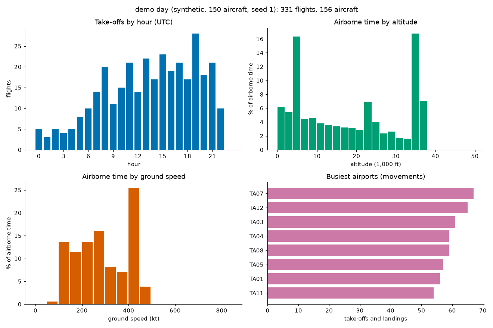
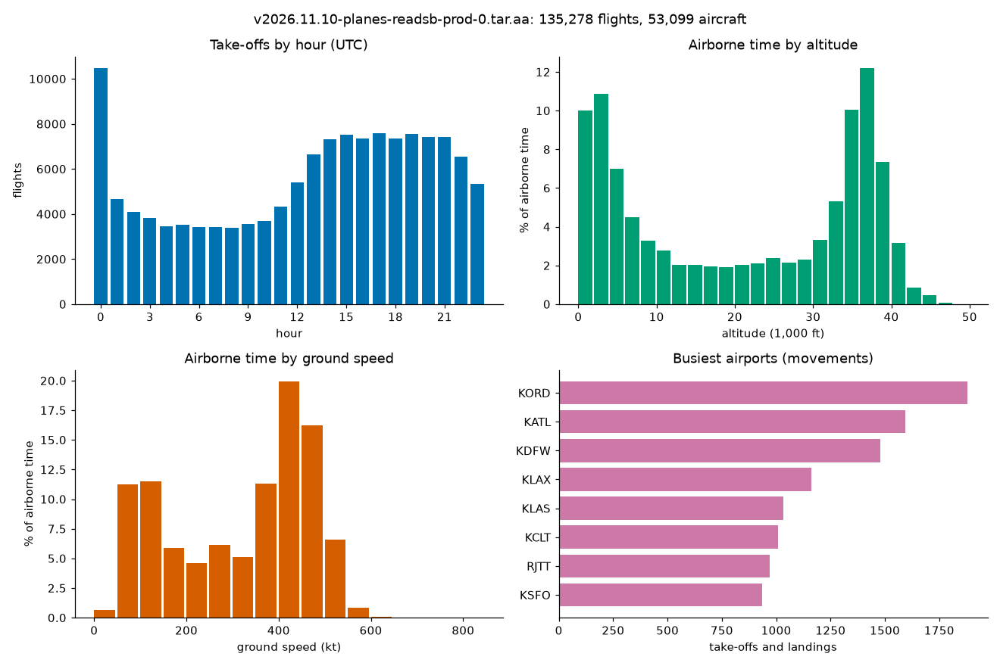

# adsbstat: flights and traffic statistics from ADS-B traces, with every result computed twice

[](https://github.com/TexAlphaWolf/ana-adsb-flight-analytics/actions/workflows/ci.yml)
[](https://github.com/TexAlphaWolf/ana-adsb-flight-analytics/actions/workflows/codeql.yml)

-informational)


ADS-B receivers write the position of every aircraft they hear every few seconds. `adsbstat` turns a day of those traces
(the readsb format that [adsb.lol](https://adsb.lol)'s open history uses) into the questions a traffic analyst asks: **how many
flights were there, between which airports, at which hours, at what altitudes and speeds, and which aircraft types flew most?**
The raw data has glitches (a position thrown across the continent), holes, repeated timestamps and aircraft that only taxi, so
the first job is to say exactly what a flight is. Every result is computed twice: with NumPy, and with a deliberately literal
point-by-point implementation of the same definition. A generator that knows the truth about every flight and every fault it
put into the traces scores what the analysis finds. A command line (`adsbstat`) with tests, a Docker image and reports generated
from the numbers.



## What the numbers say

The demo day ([`docs/report.json`](docs/report.json)) is a generated day of 150 aircraft (plus 6 that never fly). **It is
synthetic**: the faults are the ones the generator injects, so a detection score is a ceiling and not an estimate of what you
would find in real traces; a real day is analysed separately in [A real day](#a-real-day). Speed figures are from one
run in Docker on Linux x86_64 with 12 CPUs and Python 3.14.10 ([`docs/bench.json`](docs/bench.json); medians of 5 runs, 2 for the
literal implementation).

1. **The analysis finds every flight and handles every injected fault in 20 generated days.** Each day has 200 aircraft and a
   mix of 7 kinds of fault: 960 faults injected in all, 8,692 true flights, 8,692 found, 0 extra; origin airport right for 8,692
   and destination for 8,692; 280 of 280 position glitches removed. The distance of a flight is within 0.013% of the true one in the
   worst case. This says the definitions and the generator mean the same thing; it does not say real traces have no other kinds
   of trouble.
2. **Two implementations, one answer.** The NumPy implementation and the literal one give the same flights, counts and histograms
   on 26 comparisons (generated traffic, and random traffic that was spoiled on purpose: shuffled order, repeated times, missing
   altitudes and speeds, random flags, runs of wild positions, random parameters, airports on the same spot): 31,259 values,
   largest relative difference 1.5e-15.
3. **The demo day has 331 flights and the analysis finds the same 331.** 115,347 position reports from 156 aircraft: 189,615 km
   flown in 349.0 hours, the busiest hour for take-offs is 19:00 UTC, and 36.1% of the airborne time is spent above 24,000 ft.
   It removes 11 glitches and finds 4 flights that start and 4 that end in mid-air, so their origin or destination stays unknown.
4. **The analysis is linear in the number of reports, about a million reports a second.** 100 aircraft (80,430 reports) take
   83.0 ms and 2,000 aircraft (1,437,011 reports) take 2.02 s: 24 times more for 18 times the reports.
5. **Reading the files is the slow part.** The gzip and JSON parsing runs at 215,559 reports a second from a directory and 173,569
   from a tar archive, 4.5 times as long as the analysis of the same traces. NumPy is only 2.8 times faster than the literal
   implementation, because both spend most of their time in Python code that handles one aircraft at a time.

[`docs/analysis.md`](docs/analysis.md) goes through the results; [`docs/method.md`](docs/method.md) defines the file format and
what a flight is, exactly; [`docs/architecture.md`](docs/architecture.md) shows how the pieces fit;
[`docs/report.md`](docs/report.md) and [`docs/bench.md`](docs/bench.md) are the generated reports.

## A real day

One real day, not a generated one: `v2026.11.10-planes-readsb-prod-0.tar.aa`, the first part (2.0 GB) of adsb.lol's archive for
10 November 2026, with OurAirports' `airports.csv`, run with `tools/run_real.ps1` in Docker on a Windows PC
([`docs/real.json`](docs/real.json), [`docs/real.md`](docs/real.md)). The archive part ends in the middle of a file, so the reader
flags it as truncated and keeps everything before the cut. There is no ground truth here: these are what the definitions give on
real traffic, not a measure of correctness.



1. **53,099 aircraft and 72,983,747 position reports became 135,278 flights**: 78,442,703 km flown in 134,619.7 hours. The median
   flight is 46 minutes and 320 km; the 90th percentile is 125 minutes and 1,495 km. 49.6% of the airborne time is above 24,000 ft.
2. **It took 547 s, 133,545 reports a second**, reading and analysing in one pass, about 24% below the 176,349 a second of the
   synthetic benchmark. Memory stays small because one aircraft is analysed at a time (about 236 MiB in a `docker stats` sample).
3. **The busiest hour is 00:00 UTC (10,469 take-offs) and it is an artefact of the cut at midnight.** 5,057 flights are
   already in the air when the day begins, so the first position is counted as the take-off; without them hour 00 has 5,412
   take-offs, in line with 5,321 at 23:00. The mirror image at the end of the day is 5,147 flights still in the air.
4. **39.2% of the flights have no origin and 40.0% no destination** (53,064 and 54,137 of 135,278), against 1.2% in the demo.
   The midnight cut explains about 5,000 of each. The rest start or end where no airport within 8 km below 3,000 ft was seen,
   for instance coverage lost on the way down, or an airfield that is not in `airports.csv`; the two are not separated here.
5. **16,842 flights (12.4%) start and end at the same airport**, and the busiest "routes" are of that kind (KDAB to KDAB 267,
   KFFZ to KFFZ 230, KSFB to KSFB 160): local flying and training. The busiest airport is KORD with 1,878 movements.
6. **Glitches are rare: 624 removed in 72,983,747 reports** (8.5 per million). The 10 most flown types start with the
   Cessna 172 (10,423 flights), then the Boeing 737-800 (9,293); 8,141 flights (6.0%) have no type in the trace.

The part is not a sample of the world: 8 of the 10 busiest airports are in the United States. A whole day is this part and the
next one (`.tar.ab`), which was not read.

## Quick start

With Docker (nothing else to install):

```bash
docker build -t adsbstat .
docker volume create adsbv
docker run --rm --user 0 -v adsbv:/data --entrypoint chown adsbstat 10001 /data
RUN="docker run --rm --read-only --tmpfs /tmp --cap-drop ALL --security-opt no-new-privileges --network none -v adsbv:/data adsbstat"
$RUN generate /data/day --aircraft 40 --seed 3      # a synthetic day of traces, its airports.csv and its truth.json
$RUN analyze /data/day --out /data/out               # flights, airports, hours; scored against the truth
$RUN analyze                                         # the demo day
```

With Python 3.11 to 3.14:

```bash
pip install .
adsbstat generate day --aircraft 40 --seed 3
adsbstat analyze day --out out        # report.json, report.md and summary.png
```

For real traces, download one day of [adsb.lol's history](https://github.com/adsblol/globe_history_2025/releases) (the
`.tar.aa` part is the first piece of the archive; the reader accepts a truncated one) and the `airports.csv` of
[OurAirports](https://ourairports.com/data/), and run `tools/run_real.ps1` (Windows PowerShell, Docker) or

```bash
adsbstat analyze v2025.05.18-planes-readsb-prod-0.tar.aa --airports airports.csv --bbox 35,6,48,19 --out out
```

## Real output

`adsbstat generate day --aircraft 40 --seed 3` and `adsbstat analyze day`:

```text
written: day (42 trace files, 91 flights, faults {'glitch': 3, 'no_start': 1, 'no_end': 1, 'coverage_gap': 2, 'duplicate': 1, 'ground_only': 1, 'brief': 1})
day: 42 aircraft, 29,462 position reports, 91 flights, 45,341 km in 89.7 h
busiest hour 17:00 UTC, 29.4% of airborne time above 24,000 ft, origin unknown for 1 flights, destination for 1
3 glitches removed, 93 legs
against the truth: 91 of 91 flights found, 0 extra, origin right for 91, destination for 91
```

`adsbstat analyze` (the demo day):

```text
demo day (synthetic, 150 aircraft, seed 1): 156 aircraft, 115,347 position reports, 331 flights, 189,615 km in 349.0 h
busiest hour 19:00 UTC, 36.1% of airborne time above 24,000 ft, origin unknown for 4 flights, destination for 4
11 glitches removed, 337 legs
against the truth: 331 of 331 flights found, 0 extra, origin right for 331, destination for 331
```

## The input

`adsbstat analyze PATH` reads a directory of trace files, a tar archive of them (a truncated archive is read as far as it goes),
or a single file. A trace file is what readsb writes: one JSON document per aircraft per day, usually gzip-compressed, with
`icao`, `timestamp` and a `trace` list whose points are `[seconds after timestamp, lat, lon, altitude ft | "ground" | null,
ground speed kt, track, flags, ...]`. Names must look like `trace_*.json` or `trace_*.json.gz`. A broken file inside a directory
or archive is counted and skipped; a broken single file is an error. Airports come from an OurAirports `airports.csv` (large,
medium and small airports; the file inside a generated directory is used by default).

## Commands

| Command | What it does |
|---|---|
| `adsbstat analyze [PATH] [--airports CSV] [--truth FILE] [--bbox lat0,lon0,lat1,lon1] [--limit N] [--name TEXT] [--out DIR]` | Flights, airports, hours, altitudes, speeds (the demo day without a path); `--out` writes `report.json`, `report.md`, `summary.png` |
| `adsbstat generate DIR [--aircraft N --seed S --clean]` | Writes `traces/`, `airports.csv` and `truth.json`, a synthetic day with injected faults (none with `--clean`); refuses a directory that is not empty |
| `adsbstat verify [--draws N] [--seed S]` | Compares the two implementations; exit code 1 on a difference |
| `adsbstat bench [--sizes ...] [--ref-aircraft N] [--repeat R] [--draws N] [--seeds N] [--out DIR]` | Speed, reading, accuracy against the truth and agreement |
| `adsbstat render FILE.json [-o FILE.md] [--figure FILE.png]` | Rebuilds the Markdown (and figure) from a `report.json` or `bench.json` |

`analyze` also takes every parameter of the definition of a flight (`--jump-km`, `--max-kt`, `--gap-s`, `--min-air-points`,
`--min-air-s`, `--min-air-km`, `--airport-km`, `--low-ft`, `--weight-cap-s`, `--alt-bin-ft`, `--speed-bin-kt`); the defaults and
their meaning are in [`docs/method.md`](docs/method.md). Exit codes: 0 success, 1 a verification mismatch, 2 an error (a missing or
malformed file, a bad option, a directory that is not empty).

## What a flight is

Points are sorted by time and repeated times dropped. A point is a **glitch** when the move to it and the move from it are both
jumps (more than 2 km at more than 1,200 kt); glitches are removed. A **leg** is a stretch of trace that ends where the flags say
a new leg starts, where there is more than 30 minutes of silence, or where a jump separates two points. A leg is a **flight**
when it has at least 10 airborne points, lasts at least 5 minutes and covers at least 10 km in the air. Its **origin** is the
nearest airport within 8 km of the first airborne point, if the aircraft was at or below 3,000 ft there; the destination is the
same for the last point. Everything is defined in [`docs/method.md`](docs/method.md).

## How it is checked

- [`reference.py`](src/adsbstats/reference.py) is the same definitions written as literally as possible: one point at a time,
  every airport measured for every lookup. `adsbstat verify` compares it with the NumPy implementation in
  [`flights.py`](src/adsbstats/flights.py) on generated traffic and on spoiled traffic with random parameters. The flights,
  their order, the counts and the two histograms must be equal (floats within 1e-9).
- The **generator** ([`generate.py`](src/adsbstats/generate.py)) simulates aircraft (taxi, take-off, climb, cruise along a great
  circle, descent, landing), writes them in the readsb format and writes down every flight and every fault it injected.
  `adsbstat analyze` scores the analysis against that list when `truth.json` is there.
- Hand-computed flights (a straight east-bound leg at 360 kt, with exact distance, duration and histogram weights) go through both
  implementations in the tests, and the reader is tested on gzip, plain JSON, directories, tar archives and truncated archives.

## Development

```bash
pip install -e ".[dev]"
ruff check . && ruff format --check . && mypy && pytest --cov
```

CI runs this on Python 3.11 to 3.14, again with more random draws and another seed, on Windows and macOS, builds the Docker image
and runs the end-to-end scripts (`tools/docker_e2e.sh`, and `tools/docker_e2e.ps1` from PowerShell). `tools/run_full.ps1`
produces the measurements in this README.

## Limits

The demo and the benchmark are synthetic. One real part of a day (the first of two of 10 November 2026) has been analysed, once,
without a ground truth, so the statistics of real traffic are what the definitions give, not a checked count. A flight is an airborne stretch of a
trace, not a scheduled flight: pattern work and local flying count when they are long enough, and a flight that crosses midnight
UTC is two stretches in two daily files. Airports are named by distance only. Reading is single-threaded Python: a 2 GB part
took 9 minutes; `--limit` and `--bbox` (which filters points, after parsing) help to try it. See
[`docs/limitations.md`](docs/limitations.md).

The trace data of adsb.lol is published under the Open Database License (ODbL); this repository contains none of it.

MIT license.
